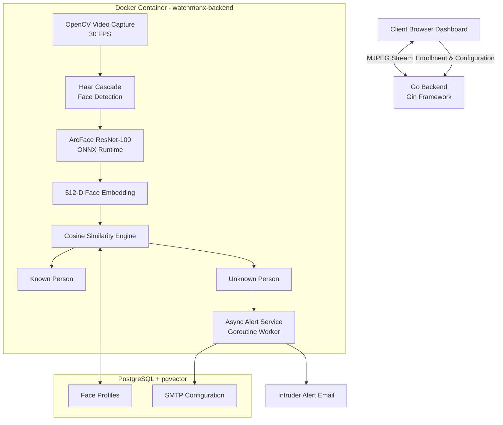

## System Architecture




# WatchmanX 👁️

WatchmanX is a real-time biometric intrusion detection platform built with Go, OpenCV, ArcFace, and PostgreSQL pgvector.

The system identifies authorized personnel, detects unknown individuals, streams live surveillance footage, and automatically sends photographic intrusion alerts via email.

---

## Key Features

- Real-time facial detection
- Face recognition using ArcFace
- PostgreSQL + pgvector similarity search
- Automatic intruder detection
- Email alerts with captured snapshots
- Live MJPEG video streaming
- Docker deployment support
- Concurrent alert processing using Goroutines
- Web-based monitoring dashboard

---

## Technology Stack

### Backend

- Go
- Gin Framework

### Computer Vision

- OpenCV
- GoCV
- Haar Cascades

### Deep Learning

- ArcFace ResNet-100
- ONNX Runtime

### Database

- PostgreSQL
- pgvector

### Alerting

- Gmail SMTP
- TLS

### Deployment

- Docker
- Docker Compose

---

## Project Structure

```text
WATCHMAN AI
│
├── Backend
│   ├── auth.go
│   ├── email_alert.go
│   ├── face_enroll.go
│   ├── source_selector.go
│   ├── surveillance.go
│   └── main.go
│
├── Cascades
│   ├── arcfaceresnet100-8.onnx
│   └── haarcascade_frontalface_default.xml
│
├── Database
│   └── database.sql
│
├── Frontend
│   ├── home.html
│   ├── login.html
│   ├── signup.html
│   ├── add_face.html
│   ├── source_selector.html
│   ├── surveillance.html
│   ├── email_config.html
│   └── instructions.html
│
├── go.mod
├── go.sum
└── README.md
```

---

## Detection Pipeline

```text
Camera Feed
    │
    ▼
Face Detection
    │
    ▼
ArcFace Embedding
    │
    ▼
pgvector Similarity Search
    │
    ▼
Known Face? ───── Yes ───► Green Bounding Box
    │
    No
    │
    ▼
Unknown Face
    │
    ▼
Capture Snapshot
    │
    ▼
Email Alert
    │
    ▼
Security Operator
```

---

## Screenshots

### Home Page

Add Screenshot Here

### Face Enrollment

Add Screenshot Here

### Live Surveillance Dashboard

Add Screenshot Here

### Unknown Person Detection

Add Screenshot Here

### Alert Email

Add Screenshot Here

---

## Performance Highlights

- Real-time processing
- 30 FPS video pipeline
- 512-dimensional facial embeddings
- Cosine similarity matching
- Asynchronous alert generation
- Goroutine-powered background processing

---

## Security Features

- Enrolled face verification
- Unknown person detection
- Alert cooldown protection
- Thread-safe email dispatch
- Secure SMTP transport (TLS)

---

## Installation

### Clone Repository

```bash
git clone https://github.com/gurumdlrdev-hub/WatchmanX
cd watchmanx
```

### Install Dependencies

```bash
go mod tidy
```

### Configure PostgreSQL

Create the database and execute:

```sql
database/database.sql
```

### Run Application

```bash
go run Backend/main.go
```

### Open Browser

```text
http://localhost:8080
```

---

## Learning Outcomes

This project provided hands-on experience with:

- Computer Vision
- Face Recognition
- Deep Learning Inference
- Vector Databases
- PostgreSQL
- Go Concurrency
- MJPEG Streaming
- Docker Deployment
- System Architecture Design

---

## Future Improvements

- Multi-camera support
- Mobile notifications
- Role-based access control
- WebSocket streaming
- Distributed deployment
- Facial recognition metrics dashboard

---

## License

MIT License
